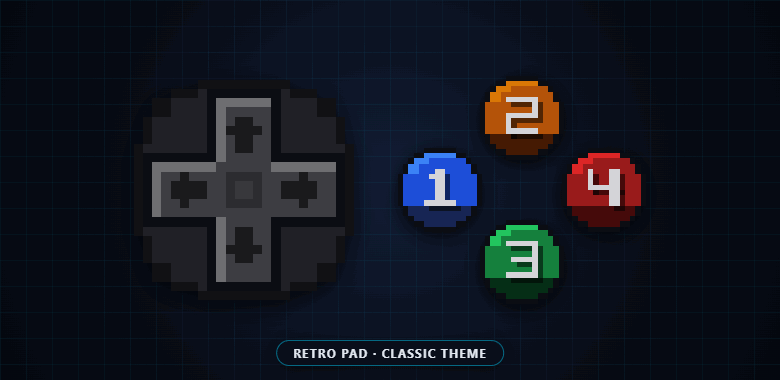
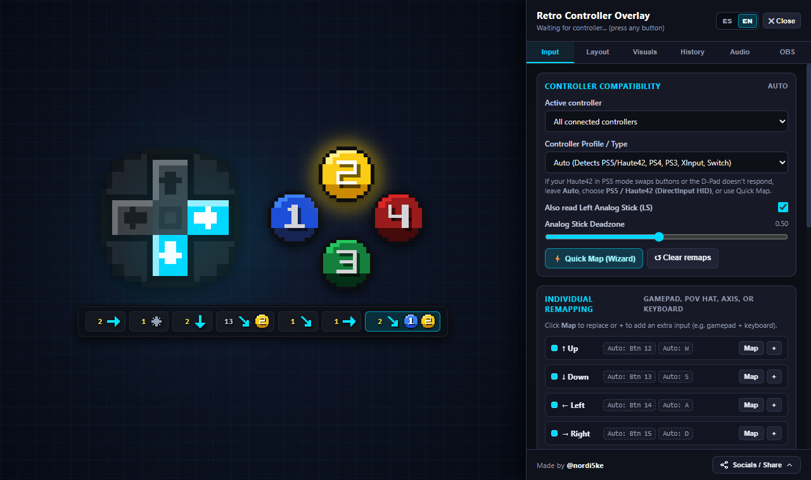
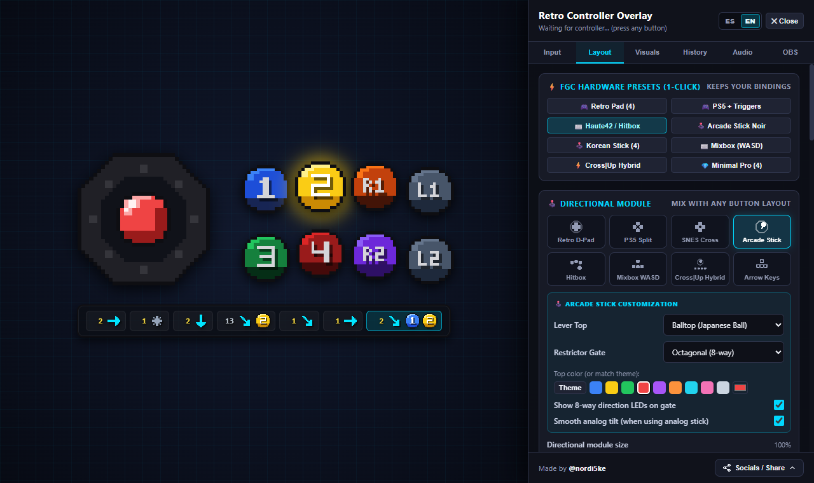
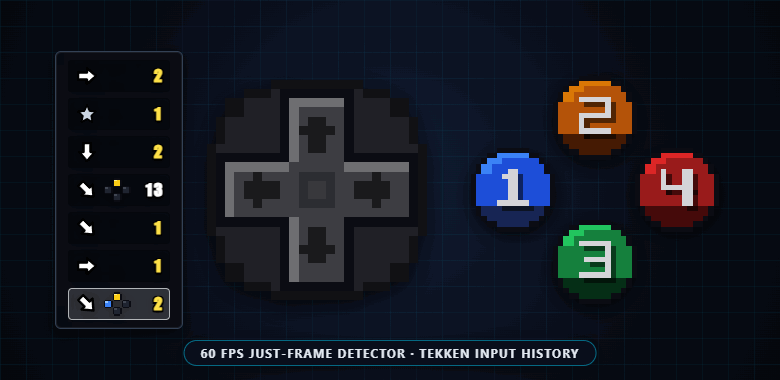
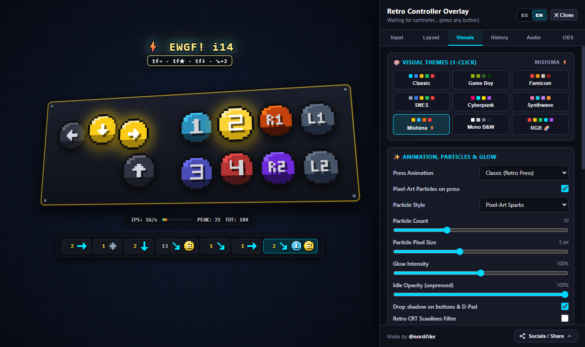
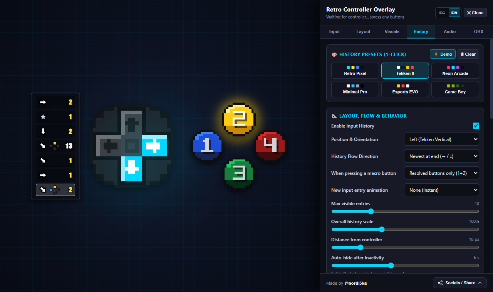
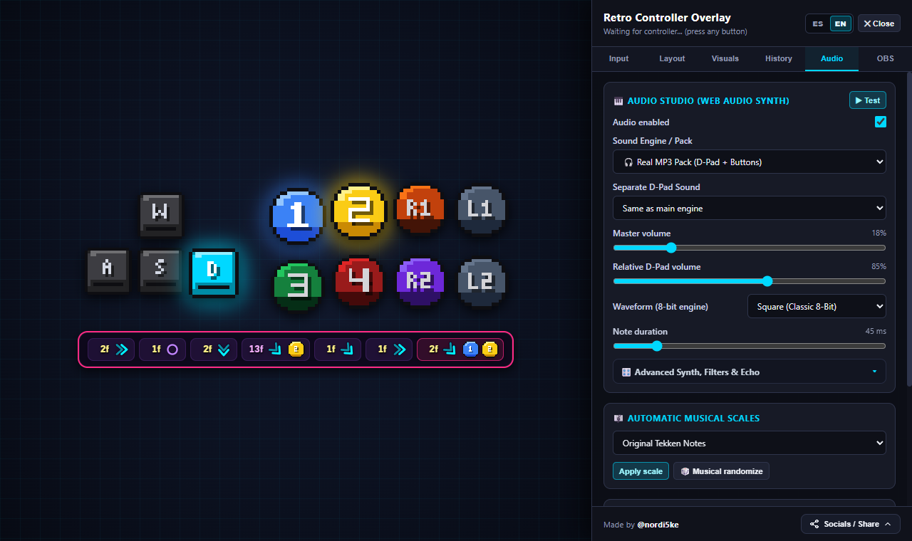
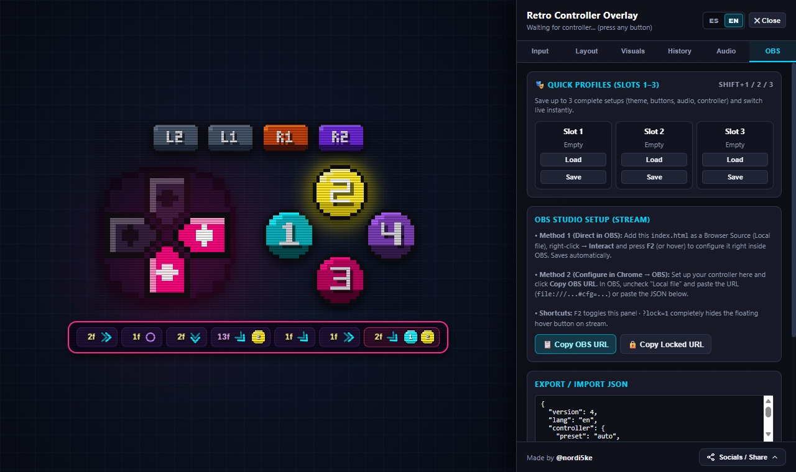

# 🎮 Retro Controller Overlay

**Pixel-art controller input overlay for Tekken & OBS Studio**  
*Single HTML file · Zero dependencies · 250 Hz polling · 60 FPS Just-Frame detector · Real tactile + 8-bit audio*

[🚀 Quick Start](#-quick-start) • [🎛️ Feature & Menu Tour](#-complete-feature--menu-tour) • [⌨️ Shortcuts & URLs](#-shortcuts--url-parameters) • [👾 Creator](#-creator--socials)

> **🎯 Designed for Tekken — Works with Any Game**  
> Currently built around **Tekken** in general (Just-Frame execution detection, Tekken input history parity, macros, and FGC layouts), **but you can use it for any other fighting game or PC game** as a clean, customizable controller input overlay. Game-specific mechanics for other titles may be added in the future.

---

---

## ⚡ At a Glance

Everything lives inside **`index.html`** — no installers, no servers, no frameworks, and zero stream lag.

| Category | What's Built In |
| :--- | :--- |
| **🎮 Hardware Support** | Auto-detects **PS5 / Haute42 (DirectInput HID)**, DualSense, DualShock 4, Xbox/XInput, Switch, PS3, SNES & Keyboard at **250 Hz** |
| **🕹️ Modular Layouts** | Mix & match **8 directional modules** (incl. Animated Arcade Stick, Hitbox, Mixbox WASD, Cross\|Up) with **7 button layouts** |
| **⚡ Tekken Detector** | Real **60 FPS** Just-Frame callouts for **PEWGF i13**, **EWGF i14**, **TJU i15/16**, **iWS+2**, **OTGF**, **JFSR**, **Acid Rain**, **iSW** & **iWS+1** |
| **📜 Input History** | Exact 60 FPS frame counters (monitor-independent), **6 presets**, **8 arrow styles**, horizontal or vertical Tekken docking |
| **🔊 Audio Studio** | **11 sound engines** including an embedded **32 kHz Real Tactile MP3 Sample Pack**, 8-Bit Chiptune, Sanwa/Kailh & separate D-Pad mixing |
| **🌍 Stream-Ready UX** | Instant **`ES \| EN`** bilingual UI, **3 Quick Profiles** (`Shift+1/2/3`), `#cfg=` portable OBS URLs & `?lock=1` stream lock |

---

## 🚀 Quick Start

Get up and running in **under 30 seconds** — choose whichever workflow fits your stream:

### Option A — Configure in Chrome/Edge → Send to OBS *(Recommended)*
1. Download **`index.html`** (or clone this repo) and open it in **Chrome** or **Edge**.
2. Press **`F2`** to customize your controller, layout, visual theme, input history, and audio.
3. Open the **OBS** tab and click **Copy OBS URL** (`#cfg=...`) or **Copy Locked URL** (`?lock=1#cfg=...` to completely hide the hover menu button on stream).
4. In OBS Studio, add a **Browser Source** *(recommended canvas: **`900 × 420`**)*, uncheck *Local file*, and paste the URL — or copy/paste your full **JSON** backup.

### Option B — Directly inside OBS Studio
1. Download **`index.html`** (or clone this repo).
2. In OBS Studio, add a **Browser Source** → check **Local file** → select `index.html` *(recommended canvas: **`900 × 420`**, transparent background by default)*.
3. Right-click the source → **Interact**, then press **`F2`** *(or hover the top-right corner)* to open the menu. Every setting saves automatically.

> **💡 Tip (GitHub Pages):** You can also fork this repo and enable **Settings → Pages → Branch: `main`** to load `index.html` from a clean HTTPS URL in OBS without managing local files.

---

## 🎛️ Complete Feature & Menu Tour

Press **`F2`** anywhere to open the settings drawer. Switch between **English** and **Spanish** at any time using the **`ES | EN`** toggle in the top-right header.

---

### 1. Input, Compatibility & Macros

Built from the ground up so **leverless controllers, fightsticks, and pads work immediately** — including tricky DirectInput HID devices like **Haute42 / GP2040-CE in PS5 mode**.

- **Automatic Profile Detection:** Instantly recognizes **PS5 / Haute42 (DirectInput HID)**, DualSense/DualShock Standard, PS3, Xbox/XInput, Nintendo Switch (HID/Pro/Swapped), and SNES USB pads — plus full **Keyboard** support.
- **250 Hz Ultra-Low Latency Engine:** Reads digital buttons, **8-way POV Hat Switches** (including diagonals), Left Analog Stick with adjustable deadzone, and analog triggers with zero dropped inputs.
- **Quick Map Wizard & Multi-Bind:** Remap your entire controller step-by-step in seconds, or click **`+`** on any action to bind multiple physical inputs (e.g., gamepad + keyboard simultaneously).
- **Multi-Input Macros (with D-Pad support):** Bind any physical trigger or button (`R1`, `R2`, `L1`, `L2`, etc.) to illuminate multiple buttons **and** directions at once — built-in 1-click presets for `1+2`, `3+4`, `Heat (2+3)`, `Rage Art (df+1+2)`, and `Ki Charge (1+2+3+4)`.
- **Live Gamepad Monitor:** Inspect raw button indices, POV hat vectors, and analog axes in real time to troubleshoot any controller effortlessly.

---

### 2. Layout — Modular FGC Controller Studio

Combine **any directional module** with **any button arrangement** without ever losing your existing bindings.

- **8 One-Click Hardware Presets:** `Retro Pad (4)`, `PS5 + Triggers`, `Haute42 / Hitbox`, `Arcade Stick Noir`, `Korean Stick (4)`, `Mixbox (WASD)`, `Cross|Up Hybrid`, and `Minimal Pro (4)`.
- **8 Directional Modules:**
  - `Retro D-Pad` · `PS5 Split` · `SNES Cross` · **`Arcade Stick`** *(animated lever with Balltop, Battop, Bullet & Capsule tops, Square/Octagonal/Circle gates, 8-way gate LEDs, custom top colors & smooth analog tilt)* · `Hitbox` · `Mixbox WASD` *(3D pixel keycaps)* · `Cross|Up Hybrid` · `Arrow Keys`.
- **7 Button Layouts + 4 Arcade Curves:** `Tekken Diamond (4)`, `Arcade / Haute42 (2 Rows)` *(with **Vewlix**, **Namco Noir**, **Sega 2P** & **Flat** curves)*, `2×2 Tekken Compact`, `Fightstick 6 (2×3)`, `Haute42 + Thumb`, `Horizontal Row`, and `2 Vertical Columns`.
- **Per-Button Pixel Editor:** Add, remove, reorder, resize, or recolor individual buttons, pick custom button/keycap pixel shapes, and type custom labels using the built-in crisp SVG pixel font — including PlayStation symbols (`□ △ ○ ✕`).
- **Flip Sides (Southpaw):** Mirror directional and button modules left-to-right in one click.

---

### 3. Visual Studio & Tekken Just-Frame Detector

Match your stream branding and showcase frame-perfect execution live on screen.

- **9 One-Click Visual Themes:** `Classic`, `Game Boy`, `Famicom`, `SNES`, `Cyberpunk`, `Synthwave`, **`Mishima ⚡`**, `Mono B&W`, and `RGB Rainbow`.
- **Animations, Particles & Enclosures:** Choose from **5 press animations** (Classic, Elastic Bounce, Punch, Pop Flash, Hitstop Shake), **5 pixel-art particle styles** (Sparks, ⚡ Mishima Lightning, Shockwave Rings, ★ 8-Bit Stars, 🔥 Fire/Heat), **4 hardware enclosures** (Pure Transparent, Retro Dark Glass, Arcade / Haute42 Panel with screws, 16-Bit CRT Box), adjustable glow/idle opacity, and a **Retro CRT Scanlines** filter.
- **Real 3D Perspective Tilt:** Pitch, yaw, and roll the controller in 3D space (`X / Y / Z`) for angled desk-cam aesthetics.
- **Live Speed HUD (IPS):** Optional compact counter displaying real-time **Inputs Per Second**, **Peak IPS**, and **Total Inputs** with an animated bar.
- **⚡ Tekken 60 FPS Just-Frame Detector:** Runs an exact 60 FPS state machine independently of your monitor refresh rate (60 / 144 / 240 / 360 Hz), triggering customizable on-screen callouts and frame breakdowns whenever you nail a strict execution move *(optional — can be toggled off when playing other games)*:

<b>📋 View all 9 supported Tekken Just-Frame moves & exact frame windows</b>

 

| Move | Startup | Exact Input Pattern |
| :--- | :---: | :--- |
| **⚡ PEWGF** *(Perfect Electric Wind God Fist)* | `i13` | `1f f → 1f ★ → d/f+2` *(or `1f f → 1f d → d/f+2`)* |
| **⚡ EWGF** *(Electric Wind God Fist)* | `i14` | `f → ★ → d → d/f+2` *(simultaneous `d/f` + `2`)* |
| **💀 Taunt Jet Upper (TJU)** | `i15 / i16` | `1+3+4` *(Taunt)* → `1f f → 1f ★ → b+2` |
| **🔥 iWS+2** *(Instant While Standing 2)* | `i19` | `f → ★ → d → d/f → b+2` *(clean crouch-dash cancel)* |
| **⚡ OTGF** *(Omen Thunder God Fist)* | `i19` | `f → ★ → d/f+1` *(simultaneous `d/f` + `1`)* |
| **🌪️ JFSR** *(Just Frame Sky Rocket)* | `i16` | `f → ★ → d/f+4` *(simultaneous `d/f` + `4`)* |
| **🌧️ Acid Rain** *(Lee Just-Frame)* | `i10` | `1 → 3:3:3` *(frame-tight rhythm kicks)* |
| **🏃 iSW** *(Instant Shining Wizard)* | `i12` | `f → ★ → f → ★ → f+2+4` *(tight running throw)* |
| **⚡ iWS+1** *(Nina / Hayashida Step)* | `i13` | `d → d/f → f → ★+1` *(or `u/f+1` crouch-cancel)* |

---

### 4. Input History Studio

Designed for **exact Tekken Training Mode parity** — including neutral frames (`★`), true 60 FPS duration counters, and accurate button-release transitions.

- **6 One-Click History Presets:** `Retro Pixel`, `Tekken 8`, `Neon Arcade`, `Minimal Pro`, `Esports EVO`, and `Game Boy` — plus a **`⚡ Demo`** button to preview a live EWGF sequence instantly while styling.
- **Flexible Docking & Flow:** Dock horizontally (**Bottom / Top**) or vertically (**Left / Right**), control entry flow direction, max visible entries, overall scale, distance from controller, and auto-hide timeout after inactivity.
- **Full Visual Customization:**
  - **8 Arrow Styles:** Pixel Art, Tekken Bold, Arcade Filled, Outline, Chevron, Minimalist, Rounded, and FGC Numpad (`1–9`).
  - **4 Neutral Icons:** Tekken Star (`★`), Minimal Dot (`•`), Neutral Ring (`○`), or Letter `N`.
  - **5 Button Display Modes:** Mini Pixel Buttons, Mini Tekken Diamond, Mini 2×2 Arcade Grid, Text Badge (`1 / 2 / HEAT`), or Plain Text (`1+2`).
  - Custom **PC system fonts**, frame-counter placement & formatting (`13` vs `13f`), and full background/border/arrow/highlight color pickers.

---

### 5. Audio Studio — Real Tactile Samples + 8-Bit Synth

Add crisp, ultra-low-latency audio feedback to your inputs with **zero external audio files** — everything runs natively via the Web Audio API.

- **🎧 Embedded 32 kHz Real Tactile MP3 Sample Pack:** Built right into `index.html` using 3 round-robin D-Pad microswitch clicks, a realistic release click, and 4 distinct tonal arcade button pops — plus split presets (`Real MP3 D-Pad Only` and `Real MP3 Buttons Only`).
- **11 Total Sound Engines:** Real MP3 Pack (×3), Classic 8-Bit Chiptune, Sanwa / Seimitsu Arcade, Kailh / Haute42 Mechanical, Game Boy / NES Chiptune, Synthwave / Laser FM, Marimba / Soft Lo-Fi Piano, 8-Bit Percussion / Beatbox, and Arcade / Tekken Impact.
- **Independent D-Pad Sound Mixer:** Mix engines freely — for example, run **Real Tactile MP3 clicks on your D-Pad** paired with **8-Bit Chiptune or Sanwa buttons**, with independent relative D-Pad volume.
- **Live DSP, Echo & Musical Scales:** Fine-tune waveforms, note duration, pitch slide, dual-oscillator chorus/detune, low-pass warmth filter, mechanical click mix, retro echo, subtle release click, and **6 automatic musical scales** *(Major Pentatonic, Minor Pentatonic, Japanese Hirajoshi, Dark Phrygian Mishima, Chromatic, and Original Tekken Notes)* or edit exact Hz frequencies per input.

---

### 6. OBS Studio, Quick Profiles & Sharing

Built for streamers who switch games, characters, or controllers mid-broadcast.

- **3 Quick Profile Slots (`Shift + 1 / 2 / 3`):** Save up to 3 complete setups (controller layout, visual theme, history style, audio pack & macros) and swap between them live with a single hotkey.
- **1-Click Portable OBS URLs:** Generate a self-contained `#cfg=...` link that packs your entire configuration into the URL hash — or click **Copy Locked URL** (`?lock=1#cfg=...`) to disable the hover menu button during broadcasts.
- **JSON Backup & Sharing:** Export your exact setup as clean JSON to back it up or share your theme with friends and community members.

---

## ⌨️ Shortcuts & URL Parameters

<b>Click to expand all keyboard shortcuts & OBS URL flags</b>

 

| Shortcut / Flag | Action |
| :--- | :--- |
| **`F2`** | Open / close the settings drawer |
| **`Esc`** | Close the settings drawer or cancel active remapping |
| **`Shift + 1 / 2 / 3`** | Instantly load Quick Profile Slot 1, 2, or 3 |
| **`WASD` / Arrows + `U I J K`** | Built-in keyboard controls (`↑ ↓ ← →` + `1 2 3 4`) |
| **`?config=1`** | Launch with the settings menu already open |
| **`?lock=1`** | Locked stream mode — completely hides the floating hover button |
| **`?lang=en` / `?lang=es`** | Force English or Spanish UI on launch |
| **`#cfg=...`** | Load a full portable configuration directly from the URL hash |

---

## 👾 Creator & Socials

Created by **[@nordi5ke](https://x.com/nordi5ke)** — built for the Tekken & Fighting Game Community.

